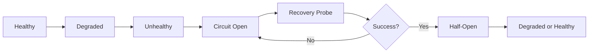

# LLM Circuit Breaker & Model Routing — Four Ollama Instances, Health Probing, Semaphore Caps

*Date created: 2026-10-22*
*Source: `api/services/llm_service.py`, `api/shared/services/ollama_model_caller.py`, `api/services/ollama_model_policy.py`*

---

## 1. The Problem

The system routes LLM requests across **four Ollama instances**:
- **ollama** — local instance on the API host (CPU fallback)
- **gpu** — dedicated GPU node for large model generation
- **cpu** — secondary CPU node (for overflow/disaster recovery)
- **pop_os** — PopOS RTX 5090 GPU (primary production GPU)

The circuit breaker prevents cascading failures when any instance becomes unhealthy, and routes requests to the right host based on model size, availability, and task type.

---

## 2. Instance Registry

### 2.1 Configuration

```python
OLLAMA_INSTANCES = {
    "ollama": {
        "host": os.getenv("OLLAMA_HOST", "http://localhost:11434"),
        "priority": 3,   # default fallback (high priority number)
        "capacity": {"generate": 8, "embed": 16},     # concurrent request caps
        "models_supported": ["llama3", "mistral"],     # small/medium models
    },
    "gpu": {
        "host": os.getenv("OLLAMA_GPU_HOST", "http://gpu-host:11434"),
        "priority": 2,
        "capacity": {"generate": 4, "embed": 8},
        "models_supported": ["llama3-70b", "mistral-large"],  # large models
    },
    "cpu": {
        "host": os.getenv("OLLAMA_CPU_HOST", "http://cpu-host:11434"),
        "priority": 4,   # lowest priority (last resort)
        "capacity": {"generate": 2, "embed": 8},
        "models_supported": ["llama3", "mistral"],
    },
    "pop_os": {
        "host": os.getenv("OLLAMA_POP_OS_HOST", "http://192.168.93.95:11434"),
        "priority": 1,   # highest priority (first choice for GPUs)
        "capacity": {"generate": 2, "embed": 4},     # RTX 5090 can only run one large model
        "models_supported": ["llama3-70b", "qwen2.5:72b"],
    }
}
```

### 2.2 Health Probing

Each instance is probed every 60 seconds via `GET /api/tags`:

```python
async def probe_ollama_health(instance_name: str) -> HealthStatus:
    """
    Returns one of:
      - HEALTHY (model list returned, latency < 2s)
      - DEGRADED (latency > 2s but responded)
      - UNHEALTHY (connection refused / timeout / error response)
    """
    resp = requests.get(f"{host}/api/tags", timeout=5)
    latency_ms = time.time() - start
    if latency_ms > 2000:
        return HealthStatus.DEGRADED
    elif resp.status_code == 200:
        return HealthStatus.HEALTHY
    else:
        return HealthStatus.UNHEALTHY
```

### 2.3 Circuit Breaker State Machine



| State | Behavior |
|-------|----------|
| **Healthy** | Route normally, track latency |
| **Degraded** | Still route, but mark as degraded for metrics/alerting |
| **Unhealthy** | Stop routing after `unhealthy_threshold` consecutive failures (default: 3) |
| **Circuit Open** | All new requests are diverted to fallback host; wait for recovery probe |
| **Half-Open** | One probe request sent every 60s; if succeeds → restore traffic |

---

## 3. Routing Logic

### 3.1 Model-Based Routing

```python
def route_request(model_name: str, task_type: str) -> Optional[str]:
    """
    Returns the best healthy instance name for the request.
    Routing priority depends on model size and task type:
    
    - Embeddings always prefer Ollama embeddings host (OLLAMA_EMBEDDINGS_HOST)
    - Large models (>7B params) require GPU-capable instances
    - Small/medium models can use any healthy instance
    """
```

#### Routing Rules

| Model Size | Task Type | Preferred Instance | Fallback Order |
|------------|-----------|-------------------|---------------|
| ≤7B params | Generate | ollama → pop_os → gpu → cpu | Priority descending |
| >7B params | Generate | pop_os → gpu → ollama → cpu | Must have GPU VRAM |
| Any size | Embed | OLLAMA_EMBEDDINGS_HOST | CPU fallback |

### 3.2 Health-Aware Selection

```python
def select_instance(task_type: str) -> InstanceCandidate:
    """
    Select the best healthy instance for a given task type.
    Considers:
    1. Circuit breaker state (skip unhealthy/circuit-open)
    2. Model requirements (GPU for large models)
    3. Current load vs capacity (semaphore)
    4. Priority rank
    """
    candidates = [
        inst for name, inst in OLLAMA_INSTANCES.items()
        if health_status(name) == HEALTHY and can_accept(task_type)
    ]
    return max(candidates, key=lambda i: i.priority)  # lowest number = highest priority
```

### 3.3 Semaphore Caps

Each instance has a **concurrent request semaphore** that limits:
- Maximum `generate` requests (model loading is expensive)
- Maximum `embed` requests (vector model loading competes with generate)

```python
import asyncio

# In llm_service.py initialization
for name, config in OLLAMA_INSTANCES.items():
    semaphores[name] = {
        "generate": asyncio.Semaphore(config["capacity"]["generate"]),
        "embed": asyncio.Semaphore(config["capacity"]["embed"]),
    }

async def with_semaphore(task_type: str):
    async with semaphores[instance_name][task_type]:
        yield  # allows one concurrent request per semaphore slot
```

---

## 4. Fallback Chain

When the primary instance fails during a request:

```python
# Pseudocode from llm_service.py
class LLMService:
    def __init__(self):
        self.fallback_chain = {
            "pop_os": ["gpu", "ollama", "cpu"],   # RTX → GPU host → local CPU
            "gpu": ["pop_os", "ollama", "cpu"],      # GPU host → PopOS → CPU
            "ollama": ["gpu", "pop_os", "cpu"],       # Local CPU → GPU → PopOS
            "cpu": ["ollama", "gpu", "pop_os"],        # Last resort
        }
    
    async def generate(self, model: str, prompt: str, task_type="generate") -> str:
        for candidate in self.fallback_chain[self.primary]:
            if health_status(candidate) != HEALTHY:
                continue
            try:
                return await call_ollama(candidate, model, prompt)
            except (ConnectionError, Timeout):
                logger.warning(f"{candidate} failed, trying next")
                continue
        raise LLMServiceUnavailable("All instances down")
```

### Fallback Triggers

| Trigger | Action |
|---------|--------|
| 504 Gateway Timeout | Try next instance in chain |
| Connection refused | Skip, try next |
| Model not found on host | Skip, try next (same model name) |
| Out of memory | Skip, try larger-instance in chain |

---

## 5. Knowledge Loop Integration

### 5.1 Circuit Breaker Awareness in Refinement Queue

When content refinement jobs are enqueued:

```python
# In content_refinement_queue_service.py
def prepare_job_for_dispatch(job):
    """
    Determine which Ollama instance to use for this job.
    Considers both circuit breaker state AND materiality priority.
    """
    if job.materiality == "material":
        # HIGH priority: require GPU
        host = route_generate_model("llama3-70b")  # triggers health check
        gpu_required = True
    else:
        # LOW priority (narrow_debt): accept CPU fallback
        host = route_generate_model("mistral", allow_cpu=True)
        gpu_required = False
    
    if health_status(host) == UNHEALTHY:
        circuit_opens[host].record_attempt()  # increment failure count
        host = circuit_rescue(host)  # auto-fallback to next healthy instance
```

### 5.2 Entity Builder Circuit Awareness

The entity profile builder service respects circuit breaker state:

```python
# In entity_profile_builder_service.py
class EntityProfileBuilderService:
    def __init__(self):
        self.circuit_breaker = OllamaCircuitBreaker()  # from llm_service
    
    async def build_profile_full_tier(self, bundle: ContextBundle) -> EntityProfile:
        if not self.circuit_breaker.can_generate():
            return await self.build_profile_fast_tier(bundle)  # degrade to fast tier
        return await self._llm_extract_context(bundle)
```

---

## 6. Monitoring & Metrics

### 6.1 Prometheus-Compatible Metrics

| Metric | Type | Labels |
|--------|------|--------|
| `ollama_health_status` | gauge | instance, status (0=unhealthy, 1=degraded, 2=healthy) |
| `ollama_latency_seconds` | histogram | instance, task_type |
| `ollama_semaphore_wait_time` | summary | instance, task_type |
| `ollama_requests_total` | counter | instance, task_type, result (success/failure) |
| `ollama_circuit_breaker_state` | gauge | instance (0=closed, 1=open, 2=half-open) |

### 6.2 Monitor Page Integration

The `/api/system_monitoring/` endpoint exposes circuit breaker state:

```python
# GET /api/system_monitoring/circuit_breakers
def get_circuit_breaker_state():
    return {
        "pop_os": {"status": "healthy", "latency_ms": 45, "circuit": "closed"},
        "gpu":   {"status": "degraded",  "latency_ms": 1800, "circuit": "closed"},
        "ollama": {"status": "healthy", "latency_ms": 120, "circuit": "closed"},
        "cpu":   {"status": "unhealthy", "attempts": 5,    "circuit": "open"},
    }
```

---

## 7. Configuration Reference

| Variable | Default | Description |
|----------|---------|-------------|
| `OLLAMA_HOST` | `http://localhost:11434` | Local CPU fallback instance |
| `OLLAMA_GPU_HOST` | `http://gpu-host:11434` | Dedicated GPU node |
| `OLLAMA_CPU_HOST` | `http://cpu-host:11434` | Secondary CPU overflow |
| `OLLAMA_POP_OS_HOST` | `http://192.168.93.95:11434` | Production RTX 5090 GPU |
| `OLLAMA_EMBEDDINGS_HOST` | `http://127.0.0.1:11435` | Ollama on PopOS (tunnel via Widow) or LAN fallback |
| `HEALTH_PROBE_INTERVAL` | `60` | Seconds between health checks |
| `UNHEALTHY_THRESHOLD` | `3` | Consecutive failures before circuit opens |
| `RECOVERY_PROBE_INTERVAL` | `60` | Seconds between recovery probes when circuit is open |

---

## 8. Key Files

- `api/services/llm_service.py` — Main LLM routing hub, circuit breaker logic
- `api/shared/services/ollama_model_caller.py` — Ollama HTTP caller with retry/fallback
- `api/services/ollama_model_policy.py` — Model size validation, GPU VRAM checks
