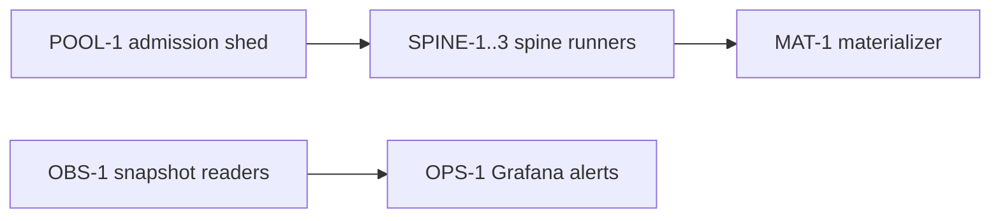

# News Intelligence — repair plan (2026-11)

Prioritized work to restore **spine throughput**, **honest observability**, and **stable pool** on Widow. Aligns with `docs/OPERATING_PRINCIPLES.md`.

**Status key:** `TODO` | `IN PROGRESS` | `DONE` (update as items land)

---

## P0 — Biggest payoff / least regret

| ID | Item | Outcome | Status |
|----|------|---------|--------|
| **OBS-1** | Prometheus + Monitor read **`read_monitor_backlog_snapshot()`** in `ni_prometheus_metrics_service` / fast poll paths — no COUNT on scrape when snapshot fresh | Grafana queues match Monitor under pool pressure | IN PROGRESS (Prometheus wired) |
| **SPINE-1** | **entity_extraction** runner/path — fix ENOENT/scheduling; prove one golden `article_id` gains entities | Spine unblocks downstream | TODO |
| **SPINE-2** | **event_extraction** — restore measurable runs when contexts pending | Chronicle/event path moves | TODO |
| **SPINE-3** | **collection_cycle** / intake — fix Task/exception failures; align with `defer_new_work` | RSS intake without pool collapse | TODO |
| **POOL-1** | **Intake shed** when `db_pool_pressure` high — honor `defer_new_work` at enqueue | Waiters ↓, API stays responsive | TODO |

**Verify OBS-1:** scrape shows `ni_pipeline_backlog_total` with pool hot **without** manual `kick_backlog_cache_refresh`.  
**Verify SPINE-*:** `automation_run_history` + pending down for phase; golden trace stage passes.

---

## P1 — Monitor v2 MVP

| ID | Item | Outcome | Status |
|----|------|---------|--------|
| **MAT-1** | Implement `api/services/metrics_materializer.py` + startup/cron hook | Rows in `pipeline.spine_health`, `pipeline.pipeline_metrics` (migration 270) | TODO |
| **MAT-2** | Expose materialized spine metrics on Monitor product lane + `ni_spine_*` Prometheus | Silent phase visible as alert condition | TODO |
| **OBS-2** | Wire `intelligence.monitor_backlog_snapshot_history` to Grafana panel (ops dashboard v2) | 14d backlog trend without ad-hoc SQL | TODO |
| **OPS-1** | Homelab: re-import `ni-ops-dashboard.json` v2; add Alertmanager rules (spine silent, metrics missing, pool pegged) | PopOS alerts match Widow reality | TODO |

Spec reference: vault handoff `2026-11-17-pipeline-debt-intake-reader-cline-handoff.md`, Cline monitor analysis (materializer).

---

## P2 — Platform hygiene

| ID | Item | Outcome | Status |
|----|------|---------|--------|
| **HYG-1** | Commit / adopt `docs/OPERATING_PRINCIPLES.md` + Cline `ni-operating-principles` skill in team workflow | Less drift, consistent “done” | IN PROGRESS |
| **HYG-2** | `.env` secret hygiene — stop tracking credentials (user-deferred scope) | Git safe | TODO |
| **HYG-3** | Skip/resolve risky migrations on Widow (`241_comprehensive`, duplicate 265/266) with ledger notes | Predictable deploy | TODO |
| **HYG-4** | **topic_clustering** + finisher queue / vault prime staleness — bounded drain after spine green | Reader freshness | TODO |
| **HYG-5** | Deploy gate in `ni-verify-change` / CI: `npm run build` + targeted pytest before Widow | Fewer broken ships | TODO |

---

## P3 — Nice-to-have / later

| ID | Item |
|----|------|
| **DOC-1** | `docs/MONITOR_V2_REDESIGN.md` — full product/spine lane UI spec |
| **INT-1** | ntfy notifications for spine silent (homelab) |
| **INT-2** | Unified-search allowlist includes `OPERATING_PRINCIPLES` + repair plan |

---

## Execution order (recommended)



1. **OBS-1** (same day) — stops false “empty queue” blindness.  
2. **POOL-1** + **SPINE-1..3** (same week) — restores throughput.  
3. **MAT-1/2** + **OPS-1** — durable Monitor v2.  
4. Golden trace re-run on fixed build → update vault handoff → mark repair items DONE.

---

## Evidence commands (Widow / MCP)

```bash
# Pool + deferral
curl -sS http://127.0.0.1:8000/api/system_monitoring/automation/status | jq '.resource_router.db_pressure'

# Snapshot age (API or SQL on automation_state)
# Phase runs last 24h — automation_run_history

# Prometheus sample
curl -sS http://127.0.0.1:8000/api/system_monitoring/prometheus | rg ni_pipeline_backlog
```

---

## Owners

| Area | Primary agent mode |
|------|-------------------|
| OBS / MAT | Cline **Act** + `ni-operating-principles` |
| SPINE / POOL | Cline **Act** + `ni-golden-trace` / `ni-pipeline-debug` |
| OPS-1 Grafana | Human on PopOS + doc in `api/monitoring/grafana/README.md` |
| Plan updates | Cline **Plan** ends with handoff referencing this file |

When an item ships, edit **Status** here and add one line to `PROJECT_STATUS.md` or vault handoff.