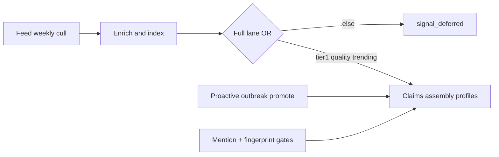

# Signal-first ops

Admission control for LLM-expensive fan-out. Config: `orchestrator_governance.yaml` → `signal_first` and `api/shared/article_signal_gate.py`.

## Bucket B levers (content that matters)

Cut sludge early, keep discovery open for one-offs, and do not burn GPU on entity long-tail.

| Lever | Role | Where |
|-------|------|--------|
| **Feed cull + quality floor** | Remove chronic low-signal *sources* before GPU | `rss_feed_health` → [`rss_feed_health_service.py`](../api/services/rss_feed_health_service.py); knobs under `rss_feed_health` in governance; article floor via `signal_first` / `quality_thresholds` |
| **Signal-first lanes** | Cap expensive fan-out; light lane still enriches/indexes | [`article_signal_gate.py`](../api/shared/article_signal_gate.py) |
| **Profile / refresh gates** | Stop long-tail entity churn (orthogonal to topic discovery) | [`entity_profile_eligibility.py`](../api/shared/entity_profile_eligibility.py); fingerprint skip in entity profile builder |
| **Proactive / outbreak** | Fast path for sudden stories — protect it | [`proactive_detection_service.py`](../api/domains/storyline_management/services/proactive_detection_service.py); per-domain `narrative.outbreak_keywords` in [`domain_synthesis_config.yaml`](../api/config/domain_synthesis_config.yaml) |

Fight noise with **feed cull** and demotions — not by raising `promote_min_articles` globally. A future topic follow list should be an **additive boost**, never the only full-lane door.

### Feed weekly cull

- Phase: `rss_feed_health` (weekly), registered in [`automation/executor.py`](../api/services/automation/executor.py).
- Policy `weekly_cull`: per pipeline schema, score active feeds with ≥ `min_articles_for_score` in `review_window_days`; if any avg quality is below `target_avg_quality`, silence up to `drops_per_review` lowest below-bar feeds (`silence_reason: weekly_cull`).
- Keep `dry_run: true` until the first cycle is reviewed in logs / Monitor feed-health counts; then set `dry_run: false`.
- Legacy `policy: warn_silence` keeps fetch/zero-yield/low-signal warn→silence.

### Profile gates (env)

| Env | Default | Meaning |
|-----|---------|---------|
| `ENTITY_PROFILE_BUILD_MIN_MENTIONS` | `3` | Min context mentions (or linked `versioned_facts`) before LLM sections |
| `ENTITY_PROFILE_STALE_DAYS` | `0` | Calendar re-queue off; mention-driven refresh only |

Do not confuse these with `ARTICLE_SIGNAL_FULL_MIN_QUALITY` / `min_importance_for_processing` (article full-lane floor).

### Outbreak / proactive

- Normal promote uses `promote_min_articles` / `promote_min_confidence` from domain synthesis config.
- Outbreak path can promote thinner clusters when `allow_promote_pair_on_outbreak` + shared keywords + credible source.
- Unlinked counts for promote/assembly already apply the full-lane article filter.

## Lanes

| Lane | Meaning |
|------|---------|
| **full** | Tier-1, or quality ≥ floor, or trending-cluster article → full desk LLM |
| **light** | Enriched but not full → mark `signal_deferred` (no LLM) |
| **skip** | Too short / not ready → wait for enrichment |

Target full-LLM ratio band: `target_full_llm_ratio_min`–`max` (governor may nudge quality floor).

## Phases that honor full-lane filters

- `unified_intake_extraction` (+ light defer)
- `topic_clustering` (+ light defer)
- `entity_extraction` / `event_extraction` (+ light defer; selection + backlog)
- `claim_extraction` via linked article (`sql_context_has_full_lane_article` + light context defer)
- Storyline assembly unlinked counts / proactive unlinked promotion

Enrichment, context sync, and indexing stay available to light-lane articles.

## Entity profile build (separate gates)

Not article-signal SQL; use:

- `ENTITY_PROFILE_BUILD_MIN_MENTIONS` (default **3**; or linked `versioned_facts`)
- Mention-driven refresh (`ENTITY_PROFILE_STALE_DAYS=0` by default — no calendar churn)
- Evidence fingerprint skip when the LLM context window is unchanged

Backlog count uses `sql_entity_profile_needs_build` (not legacy “updated in 7 days”).

## Intake shrink

`rss_feed_health` weekly cull: raise `target_avg_quality` / `drops_per_review` to cut low-signal volume before buying GPU.

## PopOS burn playbook (event → desk)

Ordered burns — do not jump to orphan/retired phases (`timeline_generation`, `event_coherence_review`, bag absorb):

1. **`story_continuation`** — drain unlinked CE (override quiet / set `STORY_CONTINUATION_ANYTIME` + recheck backoff as needed).
2. **`content_refinement_queue` / `editorial_research_pass`** — absorb materiality enqueues and research handoffs after links.
3. **`entity_profile_build`** — after entity index densifies from linked events.

**Worker caveat:** Handoffs that wake `editorial_research_pass` only drain if that phase is on a running worker. A continuation-only editorial unit will link events but will not run research; put research on refine/editorial or rely on Widow AutomationManager.

Overnight max-burn drop-ins (quiet off, desk anytime, continuation recheck 0) restore with `/tmp/overnight_max_burn_RESTORE.sh` when present — removes burn confs and restarts editorial / refine / assembly / claim-topic / uie.
